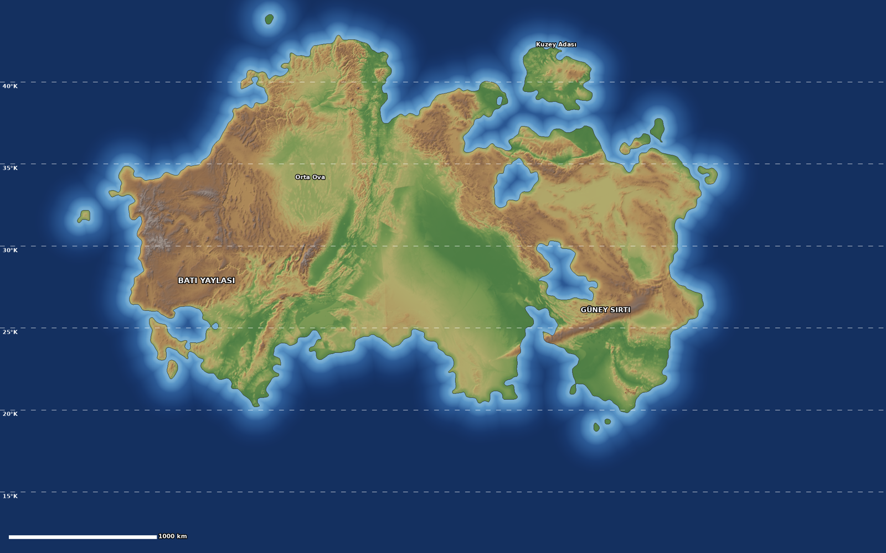

# maskeden-merak

Siyah beyaz bir kıyı maskesinden, gerçek dünya yer şekillerini (aynalayıp döndürüp bükerek) kullanan bir yükseklik haritası
ve Merak'a (merakmapmaker.com) doğrudan "Fill world" ile oturan 16 bit dosya üretir. Sahibin Merak'ta elle işlediği haritayla
birleştirme, karşılaştırma, üslup aktarımı ve elle işleme rehberi araçları da içerir.

Yöntem önce bir dünyada (Tectonic deposu, `tarih/`) adım adım geliştirildi; bu depo onun haritadan bağımsız hale getirilmiş
sürümüdür. İşi yürütecek yapay zeka ya da kişi önce **`YOL.md`**'yi okumalı.



## Hızlı başlangıç
```bash
pip install -r requirements.txt
python3 -m mk projeler/ornek maske       # maskeyi temizle, ölçeği yaz
python3 -m mk projeler/ornek parcalar    # parçaları ayır: cikti/parcalar.png
python3 -m mk projeler/ornek onizle      # her karşılığın önizlemesi
python3 -m mk projeler/ornek hepsi       # karşılık + özellik + çizim + ölçüm + Merak dosyası
python3 testler/test_merak.py            # Merak araçlarının sentetik sınaması
```
Karolar (AWS Terrain Tiles, açık veri) ilk çalıştırmada `karolar/`'a indirilir; `s3.amazonaws.com` erişimi gerekir.

## Bir proje klasörü
| dosya | içerik |
|---|---|
| `proje.json` | `maske`, `genislik_km`, `ust_enlem`, `merkez_boylam`, `merak_boyut`, isteğe bağlı `kiyi_rampa_km`, `deniz`, `tohum` |
| `maske.png` | siyah beyaz kıyı maskesi (beyaz kara) |
| `parcalar.json` | parça kesme çizgileri ve tohum noktaları |
| `karsiliklar.json` | parça ve bölgelere gerçek dünya karşılıkları (alanlar `mk/karsilik.py` başında) |
| `ozellikler.json` | sırayla uygulanan adlı düzeltmeler: `sirt`, `alcalt`, `kabart`, `cukur_doldur`, `yama` (`mk/ozellik.py`) |
| `etiketler.json` | yer adları ve konumları |
| `merak_kodlama.json` | Merak'ın ölçülmüş gri ↔ metre kodlaması (`plato` komutu yazar; yoksa varsayılan) |
| `merak_bolgeler.json` | birleştirmede bizim yükseklikle değiştirilecek çokgenler (Merak pikseli) |
| `KARARLAR.md`, `tarih.md` | sahibin kararları ve tektonik tarih (`TARIH_SABLONU.md`) |
| `cikti/` | üretilen her şey (git dışı) |

## Komutlar
`python3 -m mk PROJE KOMUT`: `maske`, `parcalar`, `onizle [AD]`, `karsilik`, `ozellik`, `ciz`, `olcum`, `hepsi`, `merak`,
`plato DISA M1 M2 ...`, `birlestir DISA [--kiyi]`, `uslup [GIRDI]`, `rehber [GIRDI]`, `fark DISA [BIZIM]`.

## Merak kodlaması (2026-11 ölçümü)
Deniz seviyesi gri değeri S = 14642 (16 bit, %22,3). Kara: `gri = S + (65535 − S)·sqrt(m / 8000)`. Deniz:
`gri = S·(1 − (−m / 6840)^0,607)`. Merak dünyası dışa aktarım boyutundadır (ör. 16000 × 7719, oran 2,073); Fill world görüntüyü
oranını koruyarak sığdırır, bu yüzden aynı boyuttaki dosya birebir oturur. Ayrıntı ve ölçüm yöntemi `YOL.md` 7. aşama.

## Dosyalar
- `mk/proje.py` proje ve ölçek; `mk/maske.py` maske ve parçalar; `mk/dem.py` gerçek yükseklik karoları;
  `mk/karsilik.py` karşılık bükme ve birleşim; `mk/ozellik.py` düzeltmeler; `mk/ciz.py` görüntü ve ölçüm; `mk/merak.py` Merak.
- `YOL.md` aşama aşama yol, sahibe sorulacaklar, tercihler, sık hatalar. `KATALOG.md` kaynak yer şekilleri. `TARIH_SABLONU.md`.
